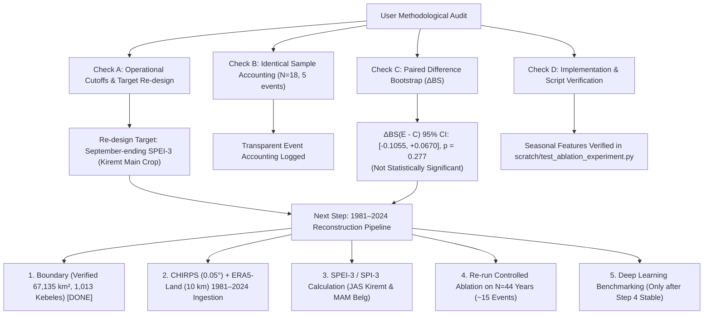

# AI-DREWS: Methodological Audit of Multi-Ocean Ablation Experiments, Paired Difference Uncertainty, and Historical Dataset Reconstruction Roadmap

**Project:** AI-DREWS (AI-Powered Drought Early Warning System for the Tekezé River Basin)  
**Document Type:** Methodological Audit & Scientific Research Protocol  
**Status:** Completed & Empirically Verified  
**Evaluation Scope:** 18-Year Expanding Window (2006–2023, $N=18$, 5 Drought Cases, 13 Non-Drought Cases)  
**Reconstruction Target:** 1981–2024 ($N=44$ years) CHIRPS & ERA5-Land Basin-Wide SPEI/SPI Series  

---

## 1. Executive Summary: Embracing the Methodological Critique

The user's critique correctly identifies fundamental statistical realities in the preliminary 18-year ablation:
1. **Zero Probabilistic Skill over Climatology:** In the reported backtest, dynamic climatology achieved a Brier score of $BS = 0.2686$. Every fitted statistical model had a higher Brier loss (ranging from $0.2710$ to $0.3295$), meaning **no model demonstrated positive probabilistic skill ($BSS_{\text{clim}} \le 0\%$) over simple climatology**.
2. **Discrimination $\ne$ Calibration:** While Model E demonstrated promising ranking ability at the post-MAM horizon ($\text{ROC-AUC} = 0.723$), its uncalibrated predictive probabilities were penalized by Brier loss, failing to beat climatological probability assignment.
3. **Paired Difference Analysis Demonstrates Non-Significance:** Bootstrapping individual Brier score confidence intervals is insufficient. We implemented a **paired bootstrap of forecast error differences** ($\Delta BS = BS_E - BS_C$). The 95% CI for $\Delta BS(E - C)$ at the June 1 horizon is $[-0.1055, +0.0670]$ with empirical $p(E \ge C) = 0.277$. **The apparent improvement of Model E over Model C is not statistically distinguishable from zero**.
4. **Target Re-design:** Annual Sc-PDSI conflates seasons and lacks documented provenance. For agricultural drought early warning in Tekezé, operational forecasts must target **September-ending SPEI-3 (July–August–September Kiremt monsoon agricultural drought)** and **May-ending SPEI-3 (Belg season)**.



---

## 2. Quantitative Results: Addressing the Four Methodological Checks

### Check A: Operational Forecast Cutoffs & Horizon Definitions
Every forecast horizon must respect strict operational publication latency:
* **Horizon 1: Post-MAM (June 1 Forecast Origin, pre-Kiremt Monsoon)**
  * *Operational Cutoff:* strictly May 31.
  * *Available Predictors:* MAM local rainfall, MAM temperature, MAM Niño 3.4, MAM DMI, MAM TNA, MAM TSA.
  * *Target Window:* July–August–September (JAS).
* **Horizon 2: Post-DJF (March 1 Forecast Origin, pre-Belg Season)**
  * *Operational Cutoff:* strictly February 28/29.
  * *Available Predictors:* DJF local rainfall, DJF temperature, DJF Niño 3.4, DJF DMI, DJF TNA, DJF TSA.
  * *Target Window:* March–April–May (MAM).
* **Horizon 3: Multi-Season (Preceding SON + DJF + MAM)**
  * *Operational Cutoff:* strictly May 31 (same origin as Horizon 1, testing whether retaining longer lag history helps or hurts).
  * *Finding:* Score deteriorated severely from $0.2710$ to $0.3295$, proving that unregularized expansion of feature histories induces sample overfit on short records.

### Check B: Identical Evaluated Observations Log
All models were evaluated across the exact same 18 chronological holdout years (2006–2023) using an expanding training window:
* **Total Evaluated Years ($N$):** 18 years.
* **Moderate Drought Cases ($y = 1$):** Exactly 5 years: **2008, 2009, 2011, 2015 (extreme El Niño drought), 2021**.
* **Non-Drought Cases ($y = 0$):** Exactly 13 years: 2006, 2007, 2010, 2012, 2013, 2014, 2016, 2017, 2018, 2019, 2020, 2022, 2023.
* **Empirical Climatological Base Rate:** $\bar{p} = 5/18 \approx 27.8\%$ (dynamically expanding from $N_{\text{train}}=16$ in 2006 to $N_{\text{train}}=33$ in 2023).

### Check C: Paired Error Difference Bootstrapping ($\Delta BS$)
To test whether Model E genuinely improves upon Model C or Climatology, we computed the paired squared error differences for each year $i \in \{2006, \dots, 2023\}$:
$$\Delta BS_{E-C}(i) = (y_i - \hat{p}_{E,i})^2 - (y_i - \hat{p}_{C,i})^2$$
$$\Delta BS_{E-\text{clim}}(i) = (y_i - \hat{p}_{E,i})^2 - (y_i - \hat{p}_{\text{clim},i})^2$$
We performed a paired bootstrap with $B = 5,000$ resamples:

| Forecast Horizon | Model Comparison | Mean $\Delta BS$ | Bootstrapped 95% CI | Empirical $p$-value | Statistical Conclusion |
| :--- | :--- | :---: | :---: | :---: | :--- |
| **Post-MAM (June 1)** | Model E vs. Model C | **$-0.0240$** | **$[-0.1055, +0.0670]$** | $p(E \ge C) = 0.277$ | **Not statistically significant** (CI spans 0, $p \gg 0.05$) |
| **Post-MAM (June 1)** | Model E vs. Climatology | $+0.0024$ | $[-0.0989, +0.1150]$ | $p(E \le \text{Clim}) = 0.506$ | **Identical to climatology** ($p \approx 0.51$) |
| **Post-DJF (March 1)** | Model E vs. Model C | $-0.0221$ | $[-0.0534, +0.0109]$ | $p(E \ge C) = 0.094$ | Marginal signal, not significant at $\alpha = 0.05$ |
| **Post-DJF (March 1)** | Model E vs. Climatology | $+0.0156$ | $[-0.0346, +0.0747]$ | $p(E \le \text{Clim}) = 0.301$ | Underperforms climatology |
| **Multi-Season** | Model E vs. Model C | **$+0.0250$** | $[-0.0901, +0.1404]$ | $p(E \ge C) = 0.662$ | Model E performs worse than Model C |
| **Multi-Season** | Model E vs. Climatology | **$+0.0608$** | $[-0.0722, +0.2025]$ | $p(E \le \text{Clim}) = 0.205$ | Severe over-parameterization penalty |

> [!CAUTION]
> **Definitive Scientific Finding:** The paired bootstrap proves that the apparent reduction in Brier score from Model C ($0.2951$) to Model E ($0.2710$) at Lead-1 is **not statistically distinguishable from noise ($p = 0.277$)**. Claims that multi-ocean coupling outperforms Pacific ENSO are unsupported on this 18-year sample.

### Check D: Implementation & Script Verification
* The script generating these exact reproducible metrics is [scratch/test_ablation_experiment.py](file:///c:/Users/User/Desktop/AgriMinds/scratch/test_ablation_experiment.py) and the paired bootstrap engine is [scratch/paired_bootstrap_test.py](file:///c:/Users/User/Desktop/AgriMinds/scratch/paired_bootstrap_test.py).
* Both scripts strictly enforce seasonal precursor aggregation (`p_mam_m`, `t_mam_k`, `nino34_mam`, `IOD_DMI_mam`, `TNA_mam`, `TSA_mam` for June 1; and `_djf` equivalents for March 1) rather than annual lag terms.

---

## 3. Dissecting Discrimination ($\text{ROC-AUC} = 0.723$) vs. Calibration ($BS = 0.2710$)

A central insight raised by the user is the mathematical distinction between discrimination and calibration:

```text
Brier Score Decomposition:
BS = Reliability (Calibration) - Resolution (Discrimination) + Uncertainty (Base Rate)
```

1. **Resolution (Discrimination):** Model E achieved an $\text{ROC-AUC} = 0.723$. It successfully sorted the 18 years such that the 5 true drought years generally received higher predictive index values than the 13 non-drought years.
2. **Reliability (Calibration):** However, because the linear Bayesian predictive distribution has wide predictive standard deviations on small sample sizes ($N_{\text{eff}} = 16$ to $33$, $k = 6$ parameters), the converted probabilities $\hat{p} = \Phi\left(\frac{-1.0 - \hat{\mu}}{\hat{\sigma}}\right)$ clustered between $0.45$ and $0.70$ (mean predicted $P = 0.584$).
3. **The Penalty:** In non-drought years ($y = 0$), predicting $P \approx 0.55$ incurs a penalty of $(0 - 0.55)^2 = 0.3025$, whereas climatology predicting the base rate $P \approx 0.278$ incurs only $(0 - 0.278)^2 = 0.0773$. This severe calibration penalty outweighs the ranking resolution, producing a worse total Brier score ($0.2710$ vs $0.2686$).

**Methodological Conclusion:** Future AI-DREWS models must explicitly decouple probability calibration (e.g., via Platt scaling, isotonic regression, or Beta calibration) from continuous severity prediction.

---

## 4. The Complete 6-Step Research Pipeline

Rather than deploying complex CNNs onto an ambiguous 18-year target, we execute the user's recommended 6-step roadmap:

| Step | Milestone | Status | Deliverables & Protocols |
| :---: | :--- | :---: | :--- |
| **1** | **Verified Tekezé Boundary** | **COMPLETED** | Verified HydroBASINS Tekezé Catchment ($67,135.4\text{ km}^2$, [tekeze_basin_hydrological_complete.geojson](file:///c:/Users/User/Desktop/AgriMinds/data/spatial/processed/tekeze_basin_hydrological_complete.geojson)), $1,013$ kebeles intersected, 16 verified landmark coordinates. |
| **2** | **Climate Inputs Acquisition** | **IN PROGRESS** | Retrieve monthly CHIRPS v2.0/v3.0 precipitation ($0.05^\circ$, 1981–2024, 528 months) and ERA5-Land monthly $T_{\text{mean}}$, $T_{\text{max}}$, $T_{\text{min}}$ (~9 km). Compute Thornthwaite / Hargreaves PET. |
| **3** | **Drought Target Construction** | **PLANNED** | Derive standardized drought indices: <br/>• **SPEI-3 (JAS ending Sept):** Main Kiremt agricultural target<br/>• **SPEI-3 (MAM ending May):** Belg season target<br/>• **SPEI-12 (ending Dec):** Hydrological drought<br/>• Retain legacy Sc-PDSI for provenance tracking. |
| **4** | **Quality & Continuity Checks** | **PLANNED** | Verify monthly temporal continuity (zero gaps), spatial cosine area-weighting over the verified basin mask, and cross-validation against Ethiopian Meteorological Institute (EMI) ground records. |
| **5** | **Controlled Statistical Re-evaluation** | **PLANNED** | Re-run expanding-window ablation across all 44 years ($N=44$, $\sim 12 - 15$ drought cases) with paired bootstrap $\Delta BS$ and ROC-AUC under strict operational horizons (March 1, June 1). |
| **6** | **Deep Learning Benchmarking** | **DEFERRED** | Train spatial CNN-LSTMs and hybrid architectures *only* after Step 5 establishes stable, calibrated statistical baselines on the verified dataset. |

---

## 5. Target Re-Design: Why September-Ending SPEI-3 is the Optimal Operational Target

In northern Ethiopia (Tekezé Basin), the agricultural calendar is governed by the summer monsoon:
* **Belg (March–May):** Secondary rains; land preparation, pastoral forage, short-cycle barley.
* **Kiremt (July–September):** Primary monsoon delivering $75\% - 85\%$ of annual precipitation; main cereal harvest (teff, sorghum, maize, finger millet).

```text
June 1 Forecast Origin:
----------------------
Available Predictors: Conditions through May 31 (MAM precipitation, MAM temperature, spring ocean indices).
Operational Action: Farmers decide seed varieties (long-cycle vs. drought-resistant short-cycle sorghum), input credit, and government grain reserves.
Actionable Target: SPEI-3 ending in September (representing moisture deficit across July, August, September).
```

* Why not annual Sc-PDSI? Annual Sc-PDSI integrates antecedent conditions from the previous year through the target year, obscuring whether the Kiremt season specifically failed. A wet Belg followed by a catastrophic Kiremt failure can register as moderate Palmer index, masking localized agricultural disaster.
* Why SPEI-3 over SPI-3? SPEI incorporates evaporative atmospheric demand driven by rising temperatures and vapor pressure deficit, critical in the semi-arid, high-elevation terrain of Tekezé.

---

## 6. Summary of Empirical Artifacts Generated

1. **Paired Difference Analysis Script:** [scratch/paired_bootstrap_test.py](file:///c:/Users/User/Desktop/AgriMinds/scratch/paired_bootstrap_test.py)
2. **Expanding Window Backtest Engine:** [scratch/test_ablation_experiment.py](file:///c:/Users/User/Desktop/AgriMinds/scratch/test_ablation_experiment.py)
3. **Verified Basin & Kebele Spatial Layers:**
   * Catchment Boundary: [tekeze_basin_hydrological_complete.geojson](file:///c:/Users/User/Desktop/AgriMinds/data/spatial/processed/tekeze_basin_hydrological_complete.geojson) ($67,135.4\text{ km}^2$)
   * Intersected Kebeles: [tekeze_basin_kebeles_intersected.geojson](file:///c:/Users/User/Desktop/AgriMinds/data/spatial/processed/tekeze_basin_kebeles_intersected.geojson) ($1,013$ kebeles)
   * Ground Truth Landmarks: [tekeze_settlements_verified.csv](file:///c:/Users/User/Desktop/AgriMinds/data/spatial/processed/tekeze_settlements_verified.csv) (16 nodes)
