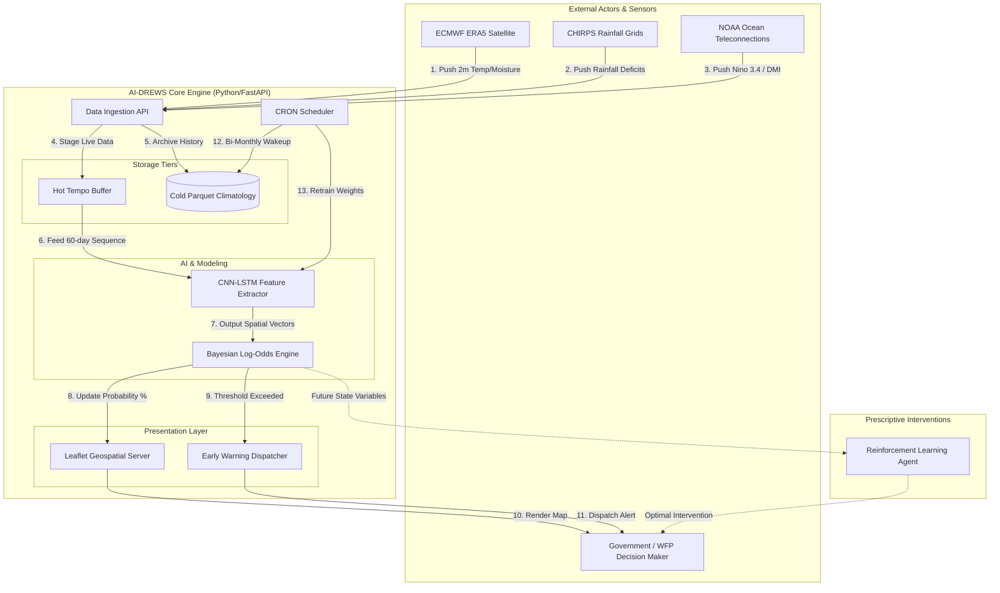

# AI-DREWS Architectural View

This diagram illustrates how raw climate telemetry flows through the system, gets processed by the Hot-Warm-Cold data pipeline, infers probabilities via Bayesian updates, and triggers geospatial early warnings.

### Architectural Highlights

1. **Hot/Cold Segregation:** 
   The flow from the data ingestion down to the Bayesian engine (Steps 1 through 8) happens dynamically in the `Hot Tempo Buffer` to ensure decision-makers see real-time updates. The heavy historical Parquet storage is explicitly kept out of the live prediction path to ensure low latency.

2. **The Bayesian Chokepoint:**
   By forcing all deep learning vectors to pass through the `Bayesian Log-Odds Engine` (Step 7), we guarantee that opaque neural network outputs are translated into calibrated, mathematically explainable probability percentages before they ever reach the UI.

3. **Bi-Monthly Retraining Disconnect:**
   Notice that the `CRON Scheduler` (Steps 12-13) sits entirely separate from the live user forecast flow. It wakes up every two months, sweeps the `Cold Parquet Climatology` for all new verified ground-truth data, and fine-tunes the CNN-LSTM weights to prevent concept drift.
